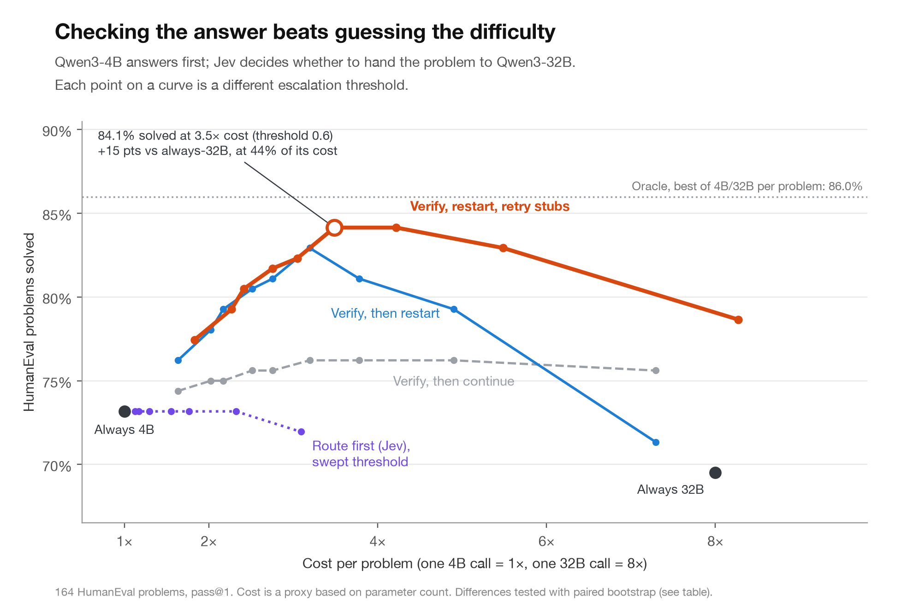

# Jev escalation: check the answer, then decide whether to escalate

On 164 HumanEval problems, checking a Qwen3-4B *answer* with Jev and conditionally restarting on Qwen3-32B outperformed routing from the prompt alone. At the illustrative threshold **p(correct) < 0.6**, restarting and retrying cold-32B stubs with a one-line 4B prefix solved **138/164 (84.1%)** at **3.49×** relative cost, versus **120/164 (73.2%)** for always-4B and **114/164 (69.5%)** for always-32B. On HumanEval+, using the same answers, scores and threshold with stricter tests: **127/164 (77.4%)** versus **111/164 (67.7%)** and **106/164 (64.6%)**, respectively. These are cached, single-sample outcomes, not a general model ranking.



[HumanEval+ frontier](charts/humanevalplus_chart_frontier.svg) · [HumanEval verification signal](charts/chart_verification.svg) · [HumanEval+ verification signal](charts/humanevalplus_chart_verification.svg) · [Interactive demo](demo/index.html) (serve over HTTP as described below). PNG and SVG versions of both chart types for both benchmarks are in `charts/`.

## Results

| Strategy | Relative cost | HumanEval pass@1 | HumanEval+ pass@1 |
| --- | ---: | ---: | ---: |
| Always 4B | 1.00× | 120/164 (73.2%) | 111/164 (67.7%) |
| Always 32B | 8.00× | 114/164 (69.5%) | 106/164 (64.6%) |
| Jev prompt-only router (default choice) | ~1.13× | 120/164 (73.2%) | 111/164 (67.7%) |
| Verify → cold 32B restart, threshold 0.6 | 3.20× | 136/164 (82.9%) | 126/164 (76.8%) |
| Verify → cold restart → first-line retry on stubs, threshold 0.6 | 3.49× | **138/164 (84.1%)** | **127/164 (77.4%)** |

At 0.6, 45/164 problems escalate and six cold 32B outputs meet the stub heuristic (`pass`, empty, or containing `your code here`). Relative cost is **1 + 8 × (escalations + retries) / 164** for the hybrid (4B = 1; 32B = 8). Prompt-only routing uses the default Jev `hard` choice; its cost is 1 + 7 × fraction routed to 32B. The score and routing choices are reused on HumanEval+, while pass/fail is retested on its stricter tests.

Paired bootstrap (2,000 resamples of the *same tasks* in each pair; seed 0, percentile 95% intervals), for the fixed 0.6 threshold:

| Pass-rate difference | HumanEval | HumanEval+ |
| --- | ---: | ---: |
| Hybrid − always 4B | +0.110 [+0.061, +0.165] | +0.098 [+0.049, +0.146] |
| Hybrid − always 32B | +0.146 [+0.085, +0.213] | +0.128 [+0.067, +0.195] |
| Cascade − prompt-only router | +0.098 [+0.049, +0.152] | +0.091 [+0.049, +0.140] |
| Hybrid − cascade | +0.012 [+0.000, +0.030] | +0.006 [+0.000, +0.018] |

The hybrid-versus-cascade intervals include zero; the additional stub retry improvement is **not** established by this test. `src/frontier.py` prints all comparisons at thresholds 0.5 and 0.6. The chart curves are threshold sweeps, not independently validated policy choices.

## Layout / reproducibility

`src/` holds generation, Jev calls, cleaning and analysis; `results/humaneval/` and `results/humanevalplus/` each hold six **cleaned** JSON files (4B, 32B, first-line continuation, half continuation, Jev verification scores and prompt router). Each contains 164 task IDs. The four generation files retain `raw_completion` alongside the trimmed `completion`. `charts/` contains cached images and `demo/index.html` computes the frontier from these JSONs without making model calls.

With Python 3.12+ and [uv](https://docs.astral.sh/uv/), from this directory:

```sh
uv sync
uv run python src/frontier.py --benchmark humaneval
uv run python src/frontier.py --benchmark humanevalplus
uv run python src/charts.py --benchmark humaneval
uv run python src/charts.py --benchmark humanevalplus
python3 -m http.server 8765  # open http://localhost:8765/demo/
```

The commands above recompute statistics/charts from the **published cached data**; chart outputs go to `charts/`. To regenerate model results rather than analyze the cache, run local OpenAI-compatible completion servers on ports 8000 (4B) and 8002 (32B), with model IDs as configured in `src/harness.py`, and configure credentials for `typesafe-sdk` / Jev System One. Then, **in a sandbox and preferably on a copy of this directory**, run `uv run python src/harness.py`, `src/jev_router.py`, `src/continuation.py`, and `src/escalation.py` (each with `uv run python`). Those scripts write/resume under `results/humaneval/` and will replace the published cleaned outputs when regenerating from scratch. Run `uv run python src/clean_all.py --rescore` to trim/retest on both suites and obtain new Jev scores (164 paid/API calls). `src/clean_all.py` without `--rescore` reuses the cached scores and refreshes router outcomes. `src/rescore_plus.py` is an alternative to retest already-trimmed HumanEval answers on HumanEval+; it does **not** rescore Jev. Dataset IDs: `openai/openai_humaneval` and `evalplus/humanevalplus`, test split. Generation is deterministic-temperature single completion with a 512-token cap, subject to server/model versions.

**Safety:** these benchmark runners execute model-generated Python in subprocesses with timeouts but **no filesystem or network sandbox**. Only run trusted cached outputs or regenerate inside an isolated container/VM. The static demo never executes completions.

## Limitations

* Relative cost is a **parameter-count proxy**, not measured dollars, tokens, wall-clock, energy or Jev inference cost. Continuation calls are costed like full 32B calls; a stub retry incurs another full 32B call.
* The 0.6 operating point was chosen with knowledge of the original HumanEval run; it was held fixed on HumanEval+, but the benchmarks share prompts and generations, so HumanEval+ is **not** an independent holdout. Treat the bootstrap intervals as descriptive conditional-on-this-sample comparisons, not correction for threshold selection or broad generalization.
* Pass@1 here is the observed pass fraction for one cached answer per task, not an estimate across many stochastic samples. Test suites are incomplete; the oracle (best of cached 4B and 32B per task) is only a diagnostic, not a deployable policy.
* The trimming fix discards any output after the first non-indented, non-empty line outside the function body, avoiding extra top-level text/code contaminating the tests. It may also discard legitimate top-level material. The Jev scores apply to the trimmed answers; scores are not included in the cost proxy.
* Dataset tests are executed directly rather than through the official isolated evaluation harness. Timeouts, dependency versions, model serving and Jev service drift may change rerun outcomes.
